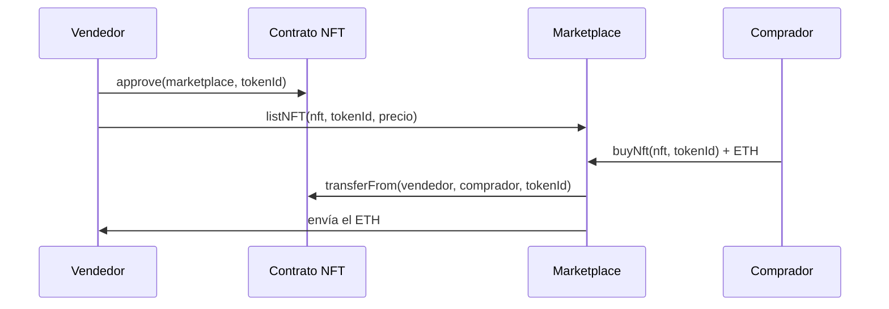

# NFT Marketplace

Marketplace descentralizado para comprar y vender NFTs **ERC-721** con ETH, construido con [Foundry](https://getfoundry.sh) y [OpenZeppelin](https://openzeppelin.com/contracts).

## Cómo funciona

El marketplace no custodia los NFTs: permanecen en la cartera del vendedor hasta que alguien los compra. Por eso el vendedor tiene que autorizar al marketplace a moverlos.



## El contrato: `NFTMarketplace.sol`

| Función | Qué hace |
|---|---|
| `listNFT(nft, tokenId, price)` | Pone a la venta un NFT. Solo puede hacerlo su dueño y el precio debe ser mayor que 0. |
| `cancelList(nft, tokenId)` | Retira el NFT de la venta. Solo puede hacerlo quien lo listó. |
| `buyNft(nft, tokenId)` | Compra un NFT listado. Hay que enviar exactamente el precio en ETH; el NFT pasa al comprador y el ETH al vendedor. |
| `listing(nft, tokenId)` | Consulta un listado: vendedor, contrato, id y precio. |

**Eventos:** `NFTListed`, `NFTCancelled` y `NFTSold`, para que una interfaz web pueda seguir la actividad del marketplace.

### Seguridad

- **`ReentrancyGuard`** (OpenZeppelin): todas las funciones usan `nonReentrant` para evitar ataques de reentrada.
- **Patrón checks-effects-interactions:** en `buyNft` el listado se borra *antes* de transferir el NFT y el ETH.
- **`Ownable`:** el contrato tiene un propietario, que es quien lo despliega.

## Tests

`test/NFTMarketplace.t.sol` incluye 9 tests que despliegan un NFT de prueba y verifican:

- Listado correcto y rechazo de precio 0 o de quien no es dueño.
- Cancelación por el vendedor y rechazo si la intenta otra cuenta.
- Compra correcta: el NFT y el ETH cambian de manos.
- Rechazo al comprar un NFT no listado o al pagar un precio incorrecto.

## Uso

Requiere [Foundry](https://book.getfoundry.sh/getting-started/installation).

```bash
git clone --recursive https://github.com/Amaia98s/NFTMarketplace.git
cd NFTMarketplace
forge build
forge test -vvv
```

## Tecnologías

Solidity 0.8.33 · Foundry · OpenZeppelin Contracts (Ownable, ReentrancyGuard, IERC721)
